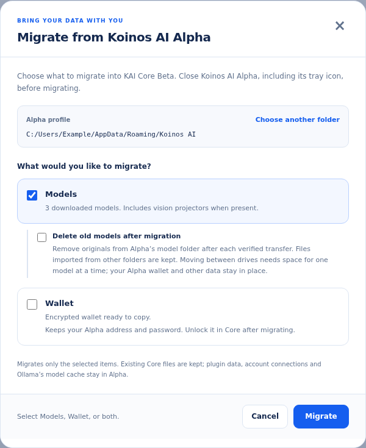
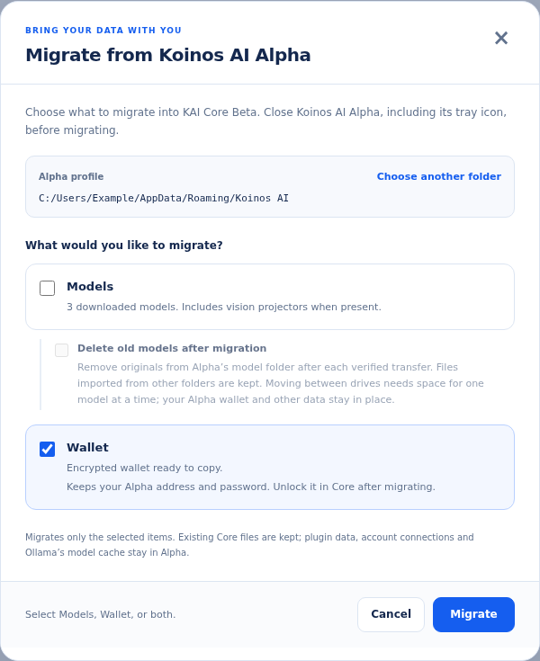
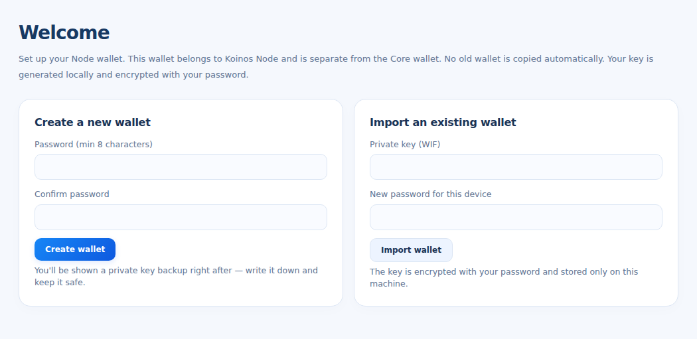
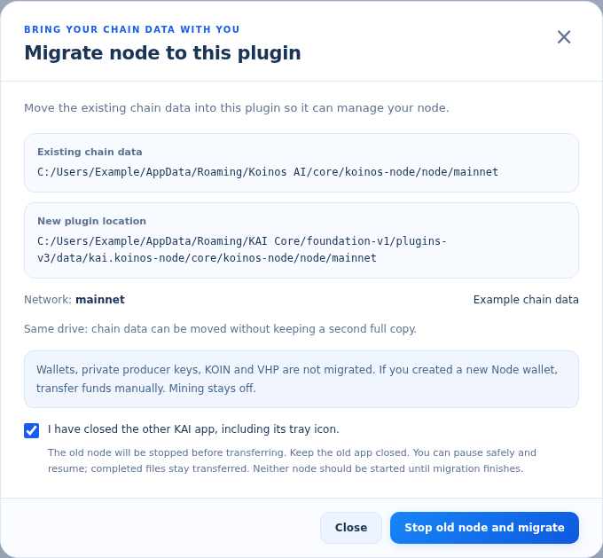

# KAI Core transfer guide

Transfer your models, Core wallet and regular Koinos Node from Koinos AI Alpha.

[Download the illustrated PDF](KAI-Core-Transfer-Guide.pdf)

Screens checked against Core 0.7.14 and KAI Koinos Node 0.3.6 on 31 October 2026. Snapshots are rendered from the app interface with example data.

## 1. Transfer your models

Move from Koinos AI Alpha to KAI Core Beta on the same computer. Models and wallet can be selected together; they are shown separately here.

**Before you begin:** Back up your wallet. Fully quit the old app, including its tray icon. Keep the old Node containers and data in place for the Node transfer later.

1. In Core, open **Settings → Migrate from Koinos AI Alpha → Migrate**.
2. Check the detected Alpha profile. Use **Choose folder** or **Choose another folder** if it is wrong.
3. Select **Models**. Leave **Delete old models after migration** off to keep the originals. Click **Migrate** and keep Core open.

**Check:** After completion, open **Models** and try one migrated model. The tool transfers downloaded GGUF models and available vision projectors; it does not transfer Ollama’s model cache.

## 2. Transfer your Core wallet

This copies your encrypted Alpha wallet into Core. It keeps the same address and password; it does not send your tokens to a new address.

1. Open the same **Settings → Migrate from Koinos AI Alpha** tool.
2. Select **Wallet**. You may select **Models** at the same time.
3. Click **Migrate** and wait for the completion message.
4. Open Core’s **Wallet**, unlock it with your existing Alpha password, and verify the address matches your old wallet.

**If Wallet is unavailable:** Core will not overwrite an existing Core wallet. Check the selected Alpha profile and the message shown; do not delete a wallet to force migration.

**Separate wallets:** This is the KAI Core wallet. We recommend creating a different wallet for your Node, as shown in the next section. Plugin data and connected accounts are not included in Alpha migration.

## 3. Create a separate Node wallet

Install the regular **KAI Koinos Node** plugin from **Plugins**, then open it from **Apps**. This guide does not use Master KAI Koinos Node.

**Recommended:** Create a new wallet specifically for your Node. **Do not use your KAI Core wallet as your Node wallet.** Keeping separate addresses helps you manage Node funds independently from your Core wallet.

1. In the Node plugin, open **Wallet**.
2. Under **Create a new wallet**, enter and confirm a password, then click **Create wallet**.
3. Save the private-key backup securely offline. Never include it in screenshots or share it in chat.

**Already have a dedicated Node wallet?** You can use **Import an existing wallet** with its WIF private-key backup and a new password for this device. Verify that it is the intended Node address, not your Core address.

**If you create a new address:** Your existing KOIN and VHP remain at the old address. Transfer the amounts you intend to use separately, checking the destination and network before confirming. Moving chain data does not move funds.

**Keep the distinction clear:** The Node wallet, chain database and production key are separate. A successful chain transfer does not automatically configure block production.

## 4. Transfer your regular Node

For a recognized Koinos AI Docker node on this computer. Leave Docker running, but fully close the old KAI app and its tray process.

1. Open the Node plugin’s **Dashboard** or **Node** page. When it detects a node managed by another profile, click **Migrate node to this plugin**.
2. Check the source, destination and network. Confirm the old app is closed.
3. Click **Stop old node and migrate**, then approve the review. Keep Core open or in its tray until the transfer finishes.

**This moves chain data only.** Same-drive files are moved; across drives, each verified file is copied and then removed from the old location. If paused, use **Resume migration**; do not start either node until it finishes.

**After completion:** The node is stopped and block production is off. Start the node, let it catch up, verify your Node wallet and balances, then configure/register its production key before enabling production. Keep the old app closed.

**No migration button?** Update the plugin and check Docker and the selected network. Arbitrary standalone Docker nodes are not supported by this migration tool; do not delete containers or chain folders to force detection.

Screen sources: [therexdev/kai-core](https://github.com/therexdev/kai-core) and [therexdev/kai-plugin-koinos-node](https://github.com/therexdev/kai-plugin-koinos-node).
